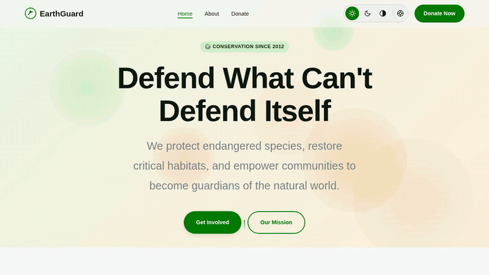

# EARTHGUARD



A landing site for EarthGuard, a wildlife conservation nonprofit: home, about and donate pages, with light, dark and high-contrast themes. **Live:** https://conservation.spiny440-hedge768.workers.dev/

> **Concept site.** EarthGuard is made up, and the donation form doesn't take payments. Claude Opus 4.6 generated the code as a design test, with every visual value coming from design tokens ([DESIGN_TOKENS.md](DESIGN_TOKENS.md)).

## Tech stack

<p>
  
</p>

## How to run and check

Needs Node.js 22.12+ and pnpm.

```sh
pnpm install
pnpm dev        # http://localhost:4321
```

```sh
pnpm build
pnpm preview    # check the production build
```
